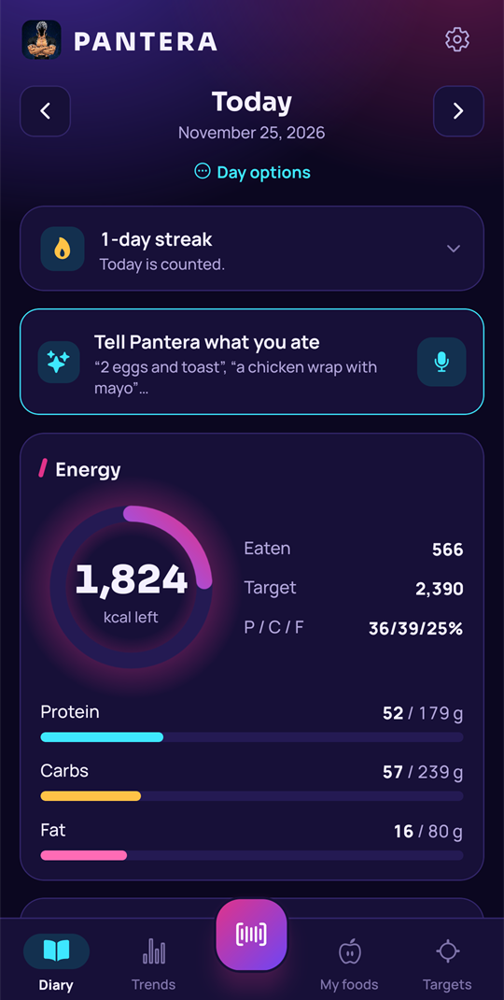
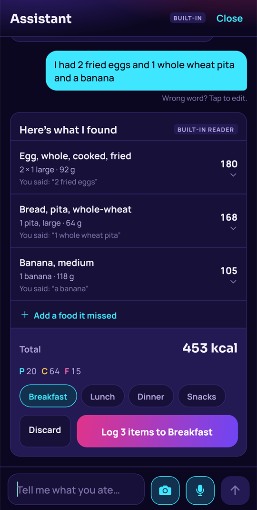
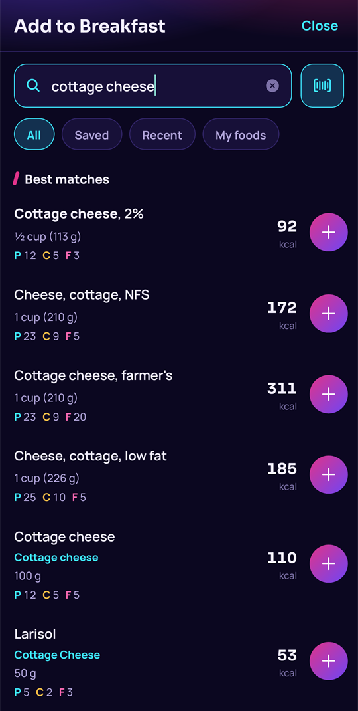
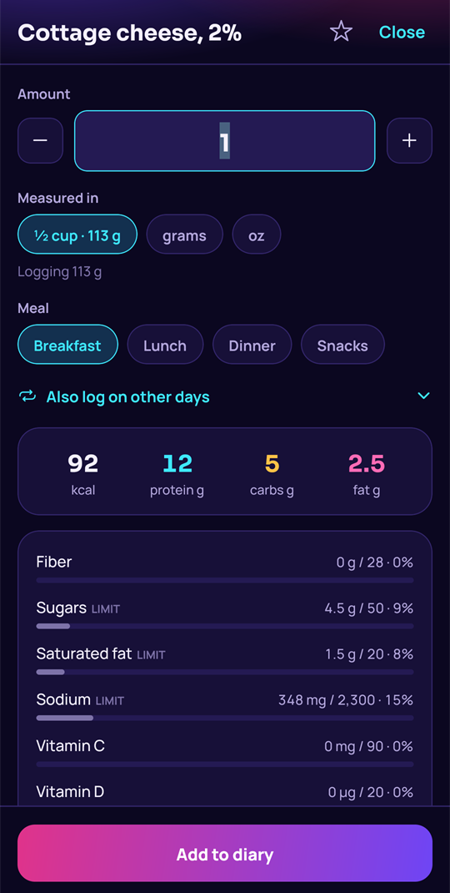

# Pantera

A calorie and nutrient tracker for Android. Search about 700,000 foods on your phone, scan a barcode, or just say what you ate. No account needed, no ads.

**[Download the app for Android](../../releases/latest)**

Pantera is an early test version made by one person. Food numbers can be wrong, so check them against the label.

| Today | Say or type a meal | Search | Food details |
|---|---|---|---|
|  |  |  |  |

## What it does

**Log food quickly**
- Search the food database built into the app, which works without internet and forgives spelling mistakes.
- Scan a barcode. A product it doesn't know can be added once from its nutrition label.
- Say or type a meal in plain words, such as "2 fried eggs and 1 pita".
- Photograph a meal (optional, needs your own AI key).
- Reuse recent foods, saved meals and recipes, or copy a whole day.

**Follow your progress**
- Calories, protein, carbs, fat and vitamins and minerals.
- A calorie target calculator, targets per weekday, and a target that adjusts to your weight trend.
- Trends, streaks and a weekly report you can save as a PDF.
- Water, weight, exercise and a fasting timer.

**More**
- Recipes, including import from a web page.
- Share a meal with a friend as a QR code or text.
- Home screen widget, reminders and a backup file.
- Optional cloud sync, using your own free Supabase project ([setup](CLOUD_SETUP.md)).

## Try it

You need an Android phone running Android 7.0 or newer. There is no iPhone version.

1. On your phone, open the **[latest release](../../releases/latest)** and download the file ending in `.apk` (about 150 MB).
2. Open the downloaded file. Android will ask you to allow installing apps from your browser or files app. Allow it.
3. Android or Play Protect may warn that the app is unknown, because it isn't from the Play Store. Choose to install it anyway only if you trust it.
4. Open Pantera. The first start takes a few seconds while the food database is set up.

Keep about 500 MB free for the first start. The app uses about 350 MB afterwards. To update later, install the newer file over the app you have.

## Good to know

- **Check important numbers.** The food data comes from public databases, partly typed in by volunteers. Some entries are out of date or wrong. Some high-fiber products, such as low-carb wraps, are a known weak spot. Entries marked **CHECK** look doubtful to the app.
- **Not medical advice.** Pantera gives estimates. Talk to a professional about diets for health conditions.
- **Voice entry** uses your phone's speech recognition, which may need internet.
- **AI features are optional.** They use a key you get from Google or Meta, and are charged or limited by them. Google requires users of its keys to be 18 or older, and requires a paid key in the European Economic Area, Switzerland and the United Kingdom. Photo reading has had little real-world testing.

## Your data

Your diary, body details and saved foods stay on your phone. There is no analytics. Searching and most barcode scans happen on the phone.

Information leaves the phone only when you use something that needs it:

| When you | What is sent | To |
|---|---|---|
| Search online, or scan a barcode the app doesn't know | The search words or barcode | Open Food Facts, USDA FoodData Central |
| Import a recipe | A request for the page | That website |
| Use AI help | Your words, or the photo you chose | Google or Meta, under your own key |
| Use voice entry | Audio | Your phone's speech service |
| Turn on cloud sync | Your email, password and app data (without AI keys) | The Supabase project you set up |
| Share a meal | The meal's name, foods and amounts | Whoever you send it to |

## Food data and credits

- [Open Food Facts](https://world.openfoodfacts.org), made available under the [Open Database License (ODbL) 1.0](https://opendatacommons.org/licenses/odbl/1-0/).
- [USDA FoodData Central](https://fdc.nal.usda.gov) and USDA Standard Reference (public domain).

The food database inside the app is built from these sources and shared under the ODbL 1.0. The scripts that build it are in [`search/`](search).

## Build it yourself

See [docs/development.md](docs/development.md).
